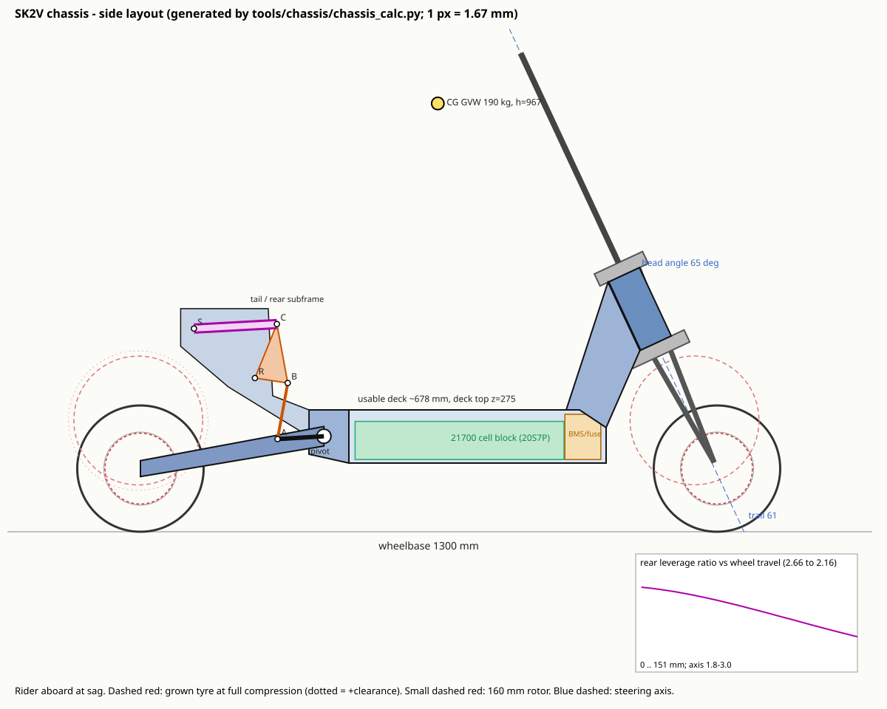

# SK2V High-Speed Scooter Chassis: Engineering Design Specification

Revision 0.1 (layout / concept-for-CAD) · 2026-10-05

> **Status:** This is a layout-level engineering specification. The geometry here has been checked with first-order kinematics and hand calculations, not with FEA or physical tests. Do not build a rideable vehicle from it until the FEA, rig tests and road tests in [H. Validation checklist](#h-validation-checklist) have been done. Nothing in this document certifies the frame for strength, IP rating, or road use.

**Companion files**

| File | Purpose |
|---|---|
| [`tools/chassis/chassis_params.json`](../../tools/chassis/chassis_params.json) | Master parameter table. Mirror these names as CAD global variables. |
| [`tools/chassis/chassis_calc.py`](../../tools/chassis/chassis_calc.py) | Calculates geometry, trail, CG, anti-squat, rear-linkage leverage curve, spring rates, tyre swept-volume clearance, battery fit, brake heating and load cases. It also writes the SVG below. `--optimise --write` re-tunes the rear linkage after a geometry change. |
| [`docs/chassis/layout_side.svg`](layout_side.svg) | Side-view layout (rider aboard, at sag), with the grown tyre at full compression and the leverage curve. |

Every number marked **(calc)** below comes from `python3 tools/chassis/chassis_calc.py` run on the committed parameter file. If you change a parameter, re-run the script; don't edit the numbers here by hand.



**Conventions:** x is forward from the rear axle, z is up from the ground, y points left. All values are in mm, N, kg and degrees. Geometry is quoted **at sag** (130 kg rider plus gear aboard), with the design tyre (11 × 3.0 envelope).

---

## 0. Conflicts, unsafe requirements and assumptions (read first)

Section 15 of the brief says nothing should be assumed silently, so these points come first. Each one changed the design.

| # | Issue | Why it matters | Resolution in this design |
|---|---|---|---|
| **C1** | **120 km/h on 6.5″-rim scooter tyres.** Most 10″/11″ scooter tyres carry no speed rating, or a rating well below 120 km/h. At 120 km/h an 11″ tyre turns about 2,240 rpm (calc), and a 10″ tyre about 2,500 rpm. | Tyre failure at speed is the most likely way this vehicle kills its rider. Frame strength can't compensate for it. | 11″ is the only configuration designed for 120 km/h, and only on a tyre with a documented speed rating of 120 km/h or more. The **10 × 2.75 option is limited to 80 km/h**, and the firmware speed limit must enforce that (`vehicle.wheel_diameter_m`, ride profiles). The tyre and motor-rim combination must pass a spin/growth test before road speeds above 80 km/h. |
| **C2** | **"11 × 2.75" and "11 × 3.0" are not standard tyre sizes.** Real 11″ tyres on 6.5″ rims are 90/65-6.5 (about 280 × 90 mm) and 100/55-6.5 (about 275–285 × 100 mm). | Clearance can't be designed to a nominal label. | The frame is designed to a **measured envelope**: OD 285, width 102, plus **2 % diameter growth and 3 mm width growth at speed** (assumed; measure it). That gives a design radius of 145.3 mm and a width of 105 mm (calc). Clearance is ≥ 12 mm radial and ≥ 8 mm lateral to that grown envelope. |
| **C3** | **160 mm rotors are thermally inadequate for 120 km/h stops.** One 120→0 stop puts about 69 kJ into the front rotor (calc, after 15 % regen). A 160 × 2.3 mm rotor (~173 g) would rise about **830 K** in bulk, and a 160 × 3.0 mm rotor about 630 K. | Fade, warping and pad glazing after one or two hard stops from top speed. | Keep **160 mm as the baseline** for packaging (see C4). Specify **3.0 mm-thick rotors**, sintered pads and 4-piston calipers. Make **regen braking mandatory**, sized for 15–25 % of stop energy. The front fork must have a +20 mm post-mount adapter path to **180 mm**. Firmware should estimate rotor temperature and derate top speed. **Repeated stops from 120 km/h aren't supported by any rotor that fits a 6.5″ hub. This is a physics limit of the platform, not a detail.** |
| **C4** | **180 mm rotor + 100 mm tyre + 140 mm dropout clash.** The rotor sits roughly 55–62 mm off centre. A caliper for a 180 rotor reaches radius ~105 mm, which is where a 100 mm tyre is at full width (±52 mm with growth). The inboard caliper half lands at about ±42 mm. | The caliper would contact the tyre sidewall. | A **180 mm rotor is only allowed with a tyre 90 mm wide or less, and only when the hub motor's rotor flange offset is 65 mm or more** (check against the motor drawing). With 160 mm and the 11 × 3.0 tyre, the binding clearance is between the inboard caliper half and the rim flange or sidewall. The hub motor sets it, not the frame, so it must be checked for each motor (H-checklist B4). |
| **C5** | **Braking is limited by pitch-over, not by grip.** With a standing rider the CG is 967 mm high (calc). At WB 1300 the stoppie limit is **0.65 g** (calc), so stopping from 120 km/h takes at least 87 m plus reaction distance. | Stopping distance is the real limit on safe speed. | The wheelbase was **raised to 1300 mm** (0.65 g, against 0.60 g at 1200). A deck top at 275 mm and a rear foot brace let the rider shift rearward (realistic 0.75–0.8 g). Stopping distance is flagged in the rider documentation. A longer wheelbase (1350–1400) helps further; see the trade-off table in §B.1. |
| **C6** | **Wheelie limit is 0.69 g** (calc). Single-motor rear drive above about 0.7 g lifts the front. | Loss of steering under hard acceleration. | Firmware needs wheelie/traction limiting (a pitch-rate or front-load estimate). Dual-motor torque split relieves this. |
| **C7** | **Power and thermal limits at 120 km/h.** Steady road load at 120 km/h is about 15.3 kW, or **18.1 kW from the battery** (calc; CdA 0.65). At about 250 A, a 20S7P pack heats roughly **15 K/min** at the cells. The firmware's hard ceiling (`docs/SAFETY.md`) is 100 A of battery current per controller, which is about 14.4 kW for two controllers at 72 V. | 120 km/h is only reachable as a short burst. With the current firmware ceilings it isn't reachable at all at 20S. | The **design top speed is 120 km/h for structural, geometry and brake load cases**. Sustained cruise should be planned at 70–90 km/h. Pack voltage is capped at **20S (84 V full)**, because the DRV8353 gate driver is rated to 100 V and 22S (92.4 V) leaves too little regen-spike margin. |
| **C8** | **Front hub motor.** Unsprung mass is about 14 kg, so the unsprung/sprung ratio is 0.17 (calc), and it adds a large steering inertia. | Worse bump absorption, and a higher risk of wobble (shimmy) on small wheels. | A **steering damper is mandatory** (mount specified). Keep the fork lowers stiff. Rear-only drive is an option for the highest-speed configuration. |
| **C9** | **Folding stem.** | Folding joints are the most common structural failure on high-speed scooters. | **A fixed (non-folding) stem is specified.** A folding version is out of scope and would need its own fatigue validation. |
| **C10** | **Deck width ≥ 180 mm.** A 180 mm deck can't hold a useful 21700 pack, closed-section side rails and wiring channels together. | Packaging. | The deck is **230 mm wide**. That gives a 190 mm internal bay, a 7-cell-wide block and two 11 mm wiring channels. A 255 mm deck allows 8P; see §E.1. |
| **C11** | **150–165 mm travel against ground clearance.** With 155 mm static clearance, both ends bottomed leave about **46 mm** (calc), before tyre deflection. | Grounding on crests and landings. | Accept it, and fit a replaceable UHMW-PE skid plate. Ground clearance and travel are parametric; each 10 mm of extra clearance raises the CG and lowers the stoppie limit by about 0.007 g. |
| **C12** | **Battery must not be structural, but the deck must be stiff.** | An open deck "tub" is torsionally weak. A load-bearing cover makes the gasket part of the structure. | The **welded tub (closed-box side rails plus a welded floor) is the structure**. The cover is **non-structural**, with a compliant gasket. The battery is a **floating module** inside the tub. |
| **C13** | **IPX6.** | It can't be claimed from a design. | The sealing *strategy* is designed for IPX6 (§E.4). Compliance requires an IEC 60529 test of the finished assembly. |
| **C14** | **Regulatory.** At 60–120 km/h this vehicle is outside PLEV standards (EN 17128 covers ≤ 25 km/h). | Test basis. | EN 17128 and ISO 4210 *test methods* are used as a floor, with loads raised to the cases in §C. On-road legality is not claimed. |

---

## A. Engineering specification

### A.1 Overall geometry

| Parameter | Value | Range / tolerance | Notes |
|---|---|---|---|
| Wheelbase (at sag) | **1300 mm** | 1250–1400 parametric | Driven by the pitch-over limit (C5) and stability. Changes over travel: rear +16 mm from top-out to bottom; front −51 mm at full fork compression. |
| Steering head angle | **65.0°** from horizontal (rake 25.0°) | 64–66° | §B.2 |
| Fork offset (perpendicular, axle ahead of axis) | **5 mm** | 0–15 via crowns | |
| Ground trail, 11 × 3.0 | **60.9 mm** (calc) | target 55–65 | normal trail 55.2 mm |
| Ground trail, 11 × 2.75 / 10 × 2.75 | 59.8 / 53.9 mm (calc) | | 10″ is limited to 80 km/h (C1) |
| Dynamic trail, hard braking (fork 90 %, rear top-out) | 43 mm, rake 18.8° (calc) | must stay > 35 | |
| Dynamic trail, hard acceleration | 76.5 mm, rake 30° (calc) | | |
| Steering lock | **±32°** | hard stops | |
| Front travel (axial) | **160 mm** (145 mm vertical) | 150–165 | |
| Rear wheel travel (vertical) | **155 mm** | 150–165 | |
| Front sag | 25 % = 40 mm axial | 20–30 % | |
| Rear sag | 30 % = 46.5 mm | 25–33 % | |
| Ground clearance (at sag) | **155 mm** | ≥ 150 | ~46 mm with both ends bottomed (C11) |
| Deck top height | **275 mm** | | |
| Deck structure height | 120 mm | | floor 5, internal 105, cover 6 (incl. gasket land) |
| Deck width (external) | **230 mm** | ≥ 180 required | C10 |
| Usable standing deck length | **678 mm** (x 372 → 1050) (calc) | ≥ 500 required | from the tail foot-brace face to the neck |
| Bar height | 1080 mm | rider-fit | bar centre lies on the steering axis at x = 857 |
| Lean angle to deck-corner contact | ~53° at sag, ~47° with +30 mm compression | | approximate |
| GVW (design) | **190 kg** | | 120 kg rider, 10 kg gear, 60 kg vehicle |
| CG (GVW, at sag) | x = 671 mm, h = 967 mm (calc) | | standing rider, CG 990 mm above the deck |
| Static weight split F/R | **51.6 / 48.4 %** (calc) | ±5 % with rider stance | |
| Pitch-over / wheelie limits | 0.65 g / 0.69 g (calc) | | C5, C6 |

### A.2 Wheels, tyres, rotors

| Parameter | Value |
|---|---|
| Supported tyres | 10 × 2.75 (≤ 80 km/h), 11 × 2.75 (≈ 90/65-6.5), 11 × 3.0 (≈ 100/55-6.5), all on 6.5″ hub-motor rims |
| Design envelope | OD 285 / W 102 static; **R 145.3 / W 105 grown** |
| Radial clearance to fixed structure, full compression, full lock | ≥ 12 mm (front achieved **28.1 mm** (calc); rear ≥ 62 mm to shock body) |
| Lateral clearance in 140 dropout | 17.5 mm per side at 11 × 3.0 grown (calc) |
| Rear dropout spacing | **140.0 mm** (+0.2/−0.0), inner faces machined after welding/heat treatment |
| Front axle spacing | defined by the fork; the frame doesn't constrain it |
| Rotor | **160 × 3.0 mm** baseline (2.3 mm allowed for testing only); front 180 mm only under the C4 conditions |
| Caliper | 4-piston hydraulic, XOD-class |
| Brake mount | post-mount **PM 74 mm** pattern, 2 × M6 × 1, faces machined; adapter-based so the XOD bolt pattern is matched by the adapter, not the frame |

### A.3 Front end interfaces

| Item | Spec |
|---|---|
| Head tube | 6061-T6, **OD 76, length 170**. Bore Ø66 H7 at both ends, depth 20, for **pressed bearing cups**, finish-bored after welding and heat treatment. Coaxiality of the two bores ≤ 0.02 mm; end faces square to the axis within 0.03 mm. |
| Bearing cups (replaceable) | Option A (preferred): 17-4PH or 7075-T6 cups taking **32006 X tapered roller bearings (30 × 55 × 17)**, for a Ø30 steerer. Option B: **ZS56** cups for 1-1/8″ or 1.5″ tapered MTB-style dual-crown steerers. The cups make the frame fork-agnostic. |
| Head bearing loads | 4.5 kN lower at the 1 g stoppie; **17.3 kN lower / 11.8 kN upper in the crash case** (calc). 32006 X C0 ≈ 58 kN, so s0 > 3. |
| Steering stops | Two machined stop lugs on the head-tube front-lower quadrant, part of the head-tube billet, with **replaceable 6 mm steel/PU stop pads** (M5). The lower crown contacts them at ±32°. |
| Steering damper | Frame boss: M8 blind thread, 15 mm deep, on the top-left of the neck, 120 mm behind the steering axis. Fork side: clamp on the upper crown. Linear hydraulic damper, about 75 mm stroke class. The mount must not limit lock. |
| Fork | Dual-crown upside-down (USD) telescopic, ~160 mm travel. A2C (axle to lower crown underside) **325 mm extended** for 11″. Lowers must have a post mount and an axle compatible with the hub motor. JREV-style speed forks are the reference class; interface by the cups and crown-clearance envelope only. |
| Crown clearance envelope | Lower-crown sweep radius from the axis ≤ 110 mm, and no frame structure inside it within ±32° (checked in CAD). |
| Stem | Fixed. A 7075-T6 tube (Ø50 × 4 minimum) clamped into the upper crown or a riser, running along the steering axis to the bar. |

### A.4 Rear suspension

| Parameter | Value (calc unless noted) |
|---|---|
| Swingarm length (pivot → axle) | **420 mm** |
| Pivot location | x = 413.6, z = 215.4 |
| Swingarm angle top-out / sag / bottom | 16.5° / 10.0° / −4.9° |
| Anti-squat (= anti-rise, since the hub motor and caliper are both on the swingarm) | 88 % top-out, **73 % at sag**, 34 % bottom |
| Linkage type | Frame-mounted rocker driven by a swingarm push-rod; shock horizontal in the tail above the rear wheel |
| Hard points (x, z) at sag | **A** push-rod lower (swingarm) 309.1, 209.1 · **R** rocker pivot (frame) 258.1, 346.9 · **B** rocker push-rod eye 332.1, 335.6 · **C** rocker shock eye 307.6, 468.7 · **S** shock frame mount 120.7, 458.5 |
| Link lengths | push-rod 128.6 (±5 adjustable = ride height) · rocker R-B 74.9, R-C 131.5 · rocker rotation 30° |
| Shock | **205 × 65 metric trunnion** (body/trunnion at S, eye at C). 210 × 55 is a fallback with a re-optimised linkage. |
| Leverage ratio | **2.66 → 2.15, mean 2.42, progression 19 %** |
| Shock sag | 17.7 mm = 27 % of stroke |
| Spring | ~**100 N/mm (575 lb/in)** coil, or an air spring with 2 volume spacers |
| Rear wheel rate / ride frequency | 15.3 N/mm / 2.1 Hz |
| Shock-mount design load | 10.8 kN (spring at full stroke × 1.6 for the bumper) |
| Bearings | Swingarm pivot: Ø20 42CrMo4 through-shaft, **4 × HK2520 + IR20×25×20**, outer bearing span ≥ 170 mm. Rocker pivot: Ø17 shaft, 2 × HK2016. Push-rod ends: **GE12** spherical plain bearings with lip seals. |

### A.5 Front suspension rates

| Parameter | Value (calc) |
|---|---|
| Front sprung load at the wheel | 824 N |
| Fork spring (total, axial) | ~18.7 N/mm (9.3 per leg) for 40 mm sag |
| Front ride frequency | 2.5 Hz |
| Progression | Air spring or oil height set so that a 1 g stop uses ≤ 85 % of travel (no anti-dive with a telescopic fork) |

### A.6 Deck, battery and electrical packaging

| Parameter | Value |
|---|---|
| Battery bay (internal) | **560 L × 190 W × 105 H = 11.2 L**, x 480 → 1040 |
| Bay layout (front → rear) | 85 mm end zone (BMS, main fuse, contactor/pre-charge, charge input), then the cell block |
| Cell block | 21700 vertical, square grid, 22.5 mm pitch: **7 × 20 = 140 cells, 453 × 160 × 86 mm** |
| Baseline pack | **20S7P**, 72 V nominal / 84 V full, 31.5 Ah with 4.5 Ah cells, **2.27 kWh**, ~9.8 kg of cells, ~13 kg as a module |
| Wiring channels | 11 mm each side, full length. Right side **HV** (rear phase leads), left side **LV** (hall, lights, comms). |
| Controller bay | Separate sealed bay inside the neck, ~200 × 100 × 90 mm, for 1–2 controllers. The neck side walls act as heat sinks. |
| Charge port | Rear-upper face of the neck, z ≈ 480–520, axis tilted 20° down, under a machined brow (§E.5) |

---

## B. Design rationale

### B.1 Wheelbase: 1300 mm

For a standing rider, braking is limited by pitch-over long before tyre grip runs out. The stoppie limit is (WB − x_cg)/h_cg (calc table):

| WB | 1150 | 1200 | 1250 | **1300** | 1350 | 1400 |
|---|---|---|---|---|---|---|
| Max decel (g) | 0.58 | 0.60 | 0.63 | **0.65** | 0.68 | 0.70 |

A longer wheelbase also lowers pitch sensitivity: a bump or throttle step produces less pitch per mm of suspension movement. It also raises yaw inertia and directional stability at speed, which helps small-wheeled vehicles because they get little gyroscopic stabilisation. The costs are turning radius, mass and a longer deck spine. 1300 mm is the compromise; the space it frees is used for the battery and a 678 mm usable deck. If tight city manoeuvring doesn't matter, go to 1350.

### B.2 Head angle 65°, offset 5 mm, trail ≈ 61 mm

- **Why not a steep 70–75° commuter angle?** Steep angles with small trail give light, nervous steering. They also let the front wheel shimmy at speed, because the self-aligning moment is small.
- **Why not motorcycle-like 24° with 100 mm trail?** Trail scales with wheel size. On a 145 mm radius wheel, 100 mm of trail would need a negative fork offset. It would also give heavy steering and large "flop" (the wheel falling into turns at low speed), and the bars would sit too far back.
- **The chosen 61 mm trail** is about 0.42 × wheel radius, slightly more than a motorcycle's ratio (≈ 0.32), to compensate for the low gyroscopic stability of the small wheel. Under hard braking, fork dive steepens the head to about 18.8°, and trail falls to 43 mm (calc). It stays positive, so the steering stays self-centring when it matters most.
- **Offset 5 mm** keeps the axle almost on the steering axis. That minimises steering inertia, which matters with an 11 kg front hub motor (C8). Crowns with 0–15 mm offset give a ±5 mm trail tuning range.
- The **steering damper** is the primary defence against wobble (6–10 Hz on wheels this size). Geometry alone doesn't suffice at 100+ km/h.

### B.3 Suspension travel, sag and frequency

- **150–165 mm** of travel was asked for, and it is reasonable for rough surfaces. It is more than speed needs (motorcycles run 120–140 mm). The main cost is ground clearance (C11).
- Sag of **25 % front / 30 % rear** keeps extension travel for unweighting over crests, which keeps the tyres in contact at speed. The front sag is lower because the fork has no anti-dive.
- Ride frequencies of **2.1 Hz rear / 2.5 Hz front** are sports-motorcycle-like. The front is slightly higher, which is conventional; it limits braking dive and suits the stiff fork required for high-speed stability.
- **19 % rising rate** in the rear gives a supple initial stroke (LR 2.66) and bottoming resistance (LR 2.15) without relying only on air-spring ramp-up. The mean LR of 2.4 is low enough that the damper is well controlled and shock seal friction doesn't dominate.

### B.4 Anti-squat and anti-rise

The hub motor's stator reacts torque into the swingarm, and the rear caliper is also mounted on the swingarm. So both drive and rear braking act along the line from the contact patch to the pivot. With the pivot 73 mm above the axle, anti-squat is **73 % at sag**:

- Under acceleration the rear sits slightly down (it doesn't jack up). That is stable, and it keeps the rider braced against the tail.
- Under rear braking the rear resists extension (anti-rise), which partly offsets weight transfer to the front.
- It falls to 34 % deep in the travel, so a landing under power isn't stiffened by drive forces.

Raising the pivot gives more anti-squat but more pedal-kickback-like feedback over bumps under power. Lowering it softens acceleration squat control. Adjust it by ±10 mm of pivot height.

### B.5 Bump steer and tyre growth

- A telescopic fork moves the axle along a straight line parallel to the steering axis, so there is no geometric bump steer. The remaining effects are trail change with pitch (quantified in §A.1) and fork flex under braking. The latter is controlled by a dual-crown fork and the stiffness targets in §C.4.
- Rear: a single swingarm with a fixed hub can't steer. Lateral swingarm compliance under cornering is the analogue, so the swingarm torsional stiffness target is in §C.4.
- **Tyre growth** is designed into every clearance check (C2). The front clearance check sweeps the grown tyre through 9 travel positions × 17 steer angles in 3-D (calc: 28.1 mm minimum against the 12 mm required).

### B.6 Rear layout choice

Three layouts were considered:

1. **Twin shocks on the deck sides**: simple, but wide, exposed to the rider's feet, and linear.
2. **A single direct-mount shock ahead of the tyre**: simple, but it needs a tall tower in the rider's rear-foot area, sits in the spray path, and has limited progression.
3. **A rocker and push-rod, with the shock horizontal in a tail above the wheel**: chosen. It keeps the deck flat and full-length for the battery, keeps the shock above the spray line and behind a fender, gives a tunable rising rate, and lets the push-rod length set ride height. Its front face (x ≈ 372) becomes a **rear foot brace**, which the rider needs at 0.7 g acceleration. The cost is four extra bearings and a tail that reaches about z = 510 mm.

---

## C. Structural layout and load paths

### C.1 Primary structure

```
           steering head (billet, cups)
                 │  neck: tapered welded box 110 × 130 × 5, internal controller bay
                 ▼
 front bulkhead ─┬─ side rail L (closed box 20 × 114, 3 mm) ─┬─ rear bulkhead / pivot block (billet)
                 ├─ welded floor 5 mm (lower flange)          ├─ swingarm pivot lugs
                 └─ side rail R                               └─ rear subframe (bolted): rocker, shock S-mount, tail
 deck cover 6 mm: NON-structural (gasketed)   battery: floating module (non-structural)
```

**Load paths:**

- **Front vertical, braking and impact loads:** tyre → fork → crowns → head bearings (a couple between the two cups, 150 mm apart) → head tube → neck box, in bending and shear → front bulkhead → side rails and floor.
- **Rear vertical loads:** tyre → hub axle → split-clamp dropouts → swingarm → (a) pivot shaft → pivot lugs → rear bulkhead → rails and floor; (b) push-rod → rocker → rocker pivot and shock → rear subframe → 4 × M10 per side into the rear bulkhead. The swingarm pivot and the subframe attachment are both on the rear bulkhead billet, so the large opposing loads (pivot about 11 kN, rocker about 19 kN in the landing case) close through one machined part, not through welds.
- **Drive and brake torque (rear):** stator flats → dropout clamp → swingarm. The rear caliper is on a post-mount boss integral with the left dropout, so braking torque never passes through a thin plate.
- **Rider load:** feet → cover → cover ribs → side-rail top flanges (cover land) and a mid cross-member. The cover carries local bending only. The battery never sees rider load.
- **Torsion (cornering, one-wheel impacts):** carried by the closed side rails plus the welded floor, which form a multi-cell closed section, and by the two bulkheads acting as torsion diaphragms. The cover is excluded so stiffness doesn't depend on its bolt torque.

### C.2 Load cases (quasi-static contact-patch forces, GVW 190 kg, W = 1864 N; from calc)

| # | Case | Front Fx / Fz (N) | Rear Fx / Fz (N) | Head bearing lower (N) | Neck root moment (N·m) | Rear shock / push-rod / rocker pivot / swingarm pivot (N) | Deck moment at rear bulkhead (N·m) |
|---|---|---|---|---|---|---|---|
| 1 | Standing, 1 g | 0 / 961 | 0 / 903 | 1,316 | 167 | 2,310 / 3,671 / 4,769 / 2,787 | 424 |
| 2 | Accel 0.7 g, rear drive | 0 / ≈0 (wheelie edge) | 1,305 / 1,873 | ≈0 | ≈0 | 3,053 / 4,852 / 6,304 / 2,934 | 600 |
| 3 | Max braking, stoppie edge, μ = 1 front | −1,864 / 1,864 | 0 / 0 | 4,543 (+2,477 axial) | 614 | 0 | 0 |
| 4 | Landing, 4 g both wheels | 0 / 3,846 | 0 / 3,610 | 5,263 | 668 | **9,238 / 14,682 / 19,077 / 11,149** | **1,697** |
| 5a | Front pothole, 4 g + 0.5 rearward | −1,923 / 3,846 | 0 / 903 | 2,055 (+4,298 axial) | 299 | (static) | 424 |
| 5b | Rear one-wheel impact, 4 g | 0 / 961 | 0 / 3,610 | 1,316 | 167 | = case 4 | 1,697 |
| 6 | Cornering 1.0 g (45° lean) | 0 / 1,359, +0.25 Fz lateral | 0 / 1,276, +0.25 Fz lateral | 1,860 | 236 | 3,266 / 5,190 / 6,744 / 3,941 | 600 |
| 7 | Brake 0.7 g + corner 0.7 g | −1,174 / 2,274 (+lat) | −130 / 0 | 1,357 | 196 | small | 28 |
| 8 | Full compression, bottom-out bumper | — | — | — | — | shock-mount design load **10.8 kN** | — |
| 9 | Fatigue spectrum | see §C.5 | | | | | |
| 10 | Frontal crash, 3.5 W rearward at the axle | −6,524 / 961 | 0 / 903 | **17,315** (upper 11,809) | **2,184** | (static) | 424 |

Out-of-plane loads (cases 6 and 7) apply a lateral force of 0.25 Fz at each contact patch. The fork, swingarm, dropouts and pivot bearings must be checked for that lateral force acting with the in-plane loads.

**What the numbers show:** global section stresses are low. The deck spine sees 35 MPa at 4 g at the rear bulkhead, and the neck box sees 25 MPa in the crash case. **This chassis is designed for stiffness and local detail strength, not global bending strength.** The critical locations are local: weld toes, lug bores, bearing seats, dropout clamps and the caliper bosses. These need FEA with hot-spot stress evaluation, not beam theory.

### C.3 Safety factors

| Check | Criterion |
|---|---|
| Normal service peaks (cases 1, 2, 3, 6, 7) | SF ≥ **2.0** against yield. Use **as-welded HAZ properties** (6061: Rp0.2 ≈ 110 MPa) within 25 mm of any weld unless the part is re-solution-treated and aged. |
| Abuse (cases 4, 5, 8) | SF ≥ **1.5** against yield and ≥ 2.0 against ultimate |
| Crash (case 10) | No fracture of the frame, head tube or welds. Plastic deformation is allowed, and the fork and stem should yield first (sacrificial). Head-tube welds ≥ 1.25 × the fork's collapse load. |
| Fatigue | Design life **30,000 km ≈ 1 × 10⁷ road cycles**. Miner sum ≤ 0.5. Weld details per IIW / EN 1999-1-3, partial factor γMf = 1.35. Aluminium has no endurance limit, so design to the 10⁷ stress range. |
| Bolted joints | VDI 2230: no separation at 1.5 × peak load, and no slip in friction joints (μ = 0.15, SF 1.25). Any bolt that carries structural load in fatigue is 10.9/12.9 with controlled torque and thread-locker. Shear joints use fitted bolts or dowels. |
| Bearings | Static safety s0 = C0/P0 ≥ 2 at the abuse peak (head bearings ≥ 3) |
| Shock and link hardware | ≥ 2 × the 10.8 kN design load to yield |

### C.4 Stiffness targets (initial; refine against a benchmark scooter)

| Stiffness | Target |
|---|---|
| Frame torsion, head tube relative to the swingarm pivot axis | ≥ 2.5 kN·m/° |
| Head-tube lateral, 1 kN at the lower bearing, rear fixed | ≤ 0.5 mm |
| Swingarm torsion, axle relative to the pivot | ≥ 0.6 kN·m/° |
| Swingarm lateral, 1 kN at the axle | ≤ 1.0 mm |

Before finalising these, measure an existing high-performance scooter (e.g. the Dualtron or Nami class) on the same rig.

### C.5 Fatigue spectrum (for FEA and rig tests)

| Event | Load | Cycles |
|---|---|---|
| Road vertical | ±0.5 g about static, each wheel | 1 × 10⁷ |
| Braking | 0.65 g front | 2 × 10⁵ |
| Acceleration | 0.6 g rear | 2 × 10⁵ |
| Potholes | 2.5 g, one wheel | 2 × 10⁴ |
| Landings | 3 g | 2 × 10³ |
| Steering reversals | ±0.25 Fz lateral | 1 × 10⁶ |

### C.6 Highest-stress areas and reinforcement

| Area | Why it is critical | Reinforcement / detail |
|---|---|---|
| **Head tube ↔ neck junction** | Braking and crash moments (2.2 kN·m) enter through two bearing seats into a welded joint | One-piece billet head tube with **integral weld preps**, so welds are ≥ 25 mm from the bearing bores. Two gussets (6 mm, top and bottom) run from the head tube into the neck side plates, with full-penetration welds and toes ground. Finish-bore after welding. |
| **Neck box** | Crash and braking bending | Tapered closed box, 110 wide × 130 deep at the head tube, 5 mm walls. Side plates waterjet-cut. Internal 4 mm baffle at mid-length, which also forms the controller bay wall. |
| **Neck ↔ deck (front bulkhead)** | Moment transfer into the rails | 10 mm machined front bulkhead with 40 mm fillet radii into the rails. Neck side plates overlap the rails by ≥ 60 mm (lap plus fillet). No weld toes at the rail corners. |
| **Rear bulkhead / pivot block** | Pivot (11 kN) and subframe loads (19 kN) close here | **One CNC billet** (6061-T651) welded into the rails at low-stress faces. Pivot bores and subframe bolt faces are machined after welding. |
| **Swingarm pivot lugs** | Lateral cornering moments | Lug thickness ≥ 14 mm. The Ø20 shaft is clamped in the lugs with pinch bolts. Bearing span ≥ 170 mm. |
| **Rear subframe (rocker R, shock S)** | Shock and rocker loads up to 19 kN | Two 12 mm 7075-T651 CNC side plates, double shear at R and S, two bolted cross-members, 4 × M10 12.9 per side into the rear bulkhead plus 2 dowels per side. |
| **Brake mounts** | 266 N·m front torque (fork); rear similar | Rear PM boss **integral with the dropout billet**. Load path dropout → swingarm leg. Boss faces ≥ 10 mm thick, spot-faced after heat treatment. |
| **Dropouts / axle** | Hub torque (peak motor plus regen), clamp fretting | Billet 7075 dropouts with **split clamp caps** (2 × M8 10.9) around the axle flats, plus flats fitting the slot with a 0.05–0.10 mm clearance. |
| **Welds generally** | HAZ strength drops to about 40 %, and weld toes start fatigue cracks | Put welds in low-stress zones, use continuous welds on closed sections (also needed for sealing), don't start or stop welds at corners, and prefer post-weld T6 (solution treatment plus artificial ageing) for the main frame. |
| **Gussets** | A gusset ending abruptly at a weld causes a stress riser | Taper gusset ends at 1:3 with a 10 mm radius at the toe. Never end a gusset at a tube edge. |

---

## D. Suspension layout

### D.1 Front

- **Type:** dual-crown USD telescopic fork, 160 mm axial travel (145 mm vertical).
- **Axle path:** a straight line parallel to the steering axis. Compression moves the axle 0.42 mm rearward per mm of travel, so the wheelbase shortens by up to 51 mm at full compression.
- **A2C:** 325 mm extended for 11″ = grown tyre radius 145 + 12 mm crown clearance + 160 mm travel + ~8 mm bump-stop and fender allowance. For the 10″ option keep the same fork, accept −15 mm of ride height and 54 mm of trail, or fit a 15 mm crown spacer.
- **Springs:** ~18.7 N/mm total axial for 40 mm sag. Air or coil, with oil-lock or hydraulic bottom-out. Progression is set for braking, because there is no anti-dive.
- **Damping:** separate compression and rebound adjusters. Start at about 0.3 critical in compression and 0.5 in rebound.
- **Front-wheel sweep:** the frame is checked against the grown tyre at every travel and steer combination (28.1 mm minimum). The fork maker must also confirm tyre-to-brace and tyre-to-fender clearance at full compression.

### D.2 Rear

- **Kinematics:** the swingarm rotates from 16.5° to −4.9°. The push-rod at A drives rocker point B upward, the rocker rotates 30° about R, and C moves rearward to compress the shock against S.
- **Leverage curve:** 2.66 → 2.15, falling smoothly (curvature limited by the optimiser). Shock stroke used is 63.9 of 65 mm, which leaves 1.1 mm for the bumper.
- **Ride-height adjustment:** push-rod length ±5 mm (left- and right-hand threaded rod ends with jam nuts) changes rear ride height by about ±20 mm (wheel-to-A motion ratio ≈ 4.0). Re-run the calc after changing it.
- **Sag procedure:** set rider sag at 46 ± 3 mm wheel (17.7 mm shock). Check free sag (vehicle only) at 5–10 mm.
- **Unsprung mass:** about 13 kg (hub motor plus wheel plus half the swingarm). Rebound damping must control that mass: rebound adjustment of 15 or more clicks is required.

### D.3 Bottom-out and travel limits

- Bottom-out is limited by the shock's internal bumper. The frame must not be a hard stop.
- Top-out is limited by the shock. A swingarm stop pad on the rear bulkhead engages 2 mm beyond shock top-out, to protect the linkage if a shock is fitted wrongly.

---

## E. Packaging layout

### E.1 Battery

| Topic | Design |
|---|---|
| **Cell arrangement** | 21700 cells standing vertically in FR-PC (UL94 V-0) holders top and bottom, 22.5 mm square pitch. 7 across × 20 along. Series groups run across the width: one 7P group per row, so 20 rows = 20S, and the busbars are short. |
| **Capacity options** | Base deck 230 → **20S7P, 2.27 kWh**. Deck 255 → 20S8P, 2.59 kWh (lean limit −2°). Staggered (honeycomb) cells → about +10 % cells but harder compression and busbar layout. A two-layer pack (+80 mm deck height) is rejected because of CG and clearance. |
| **Cell choice** | 4.5 Ah / 45 A class (e.g. Molicel P45B type). At 250 A pack current that is ~36 A per cell. Expect ~15 K/min at the cells when sustained (C7). |
| **BMS** | Front end zone, mounted **vertically** on the front bulkhead's internal face on 4 × M4 standoffs, with the conformal-coated board facing the bay. Its FETs or shunt have a thermal pad to the bulkhead. CAN to the controllers (the firmware already accepts BMS limits over CAN). |
| **Main protection** | DC fuse rated **≥ 100 V DC** with ≥ 2 kA interrupting capacity (many automotive fuses are 32–58 V only, so check the rating). Contactor or BMS FET switch with pre-charge resistor. All in the 85 mm end zone, next to the neck pass-through, so main HV runs are under 150 mm. |
| **Busbar clearance** | 16 mm headroom above the cells: busbars (Cu/Ni laminate or laser-welded Al) 1–2 mm, fish-paper 0.5 mm, balance leads, and a 3–5 mm PU compression pad. Opposite-polarity series groups have ≥ 4 mm creepage plus a fish-paper barrier. |
| **Insulation** | 0.5 mm fish-paper or polyimide on the floor, walls and lid side. Cell tops and bottoms get insulating rings. The whole module is wrapped in 0.3 mm FR-PC sheet. |
| **Compression / retention** | The module sits on a **1.5 mm thermally conductive gap pad (≥ 3 W/m·K, electrically insulating)** on the floor. A bolted top retaining frame (2 mm 5052, 4 × M6 into welded floor bosses through slotted brackets) preloads 3–5 mm of microcellular PU (Poron class) to 20–30 % compression. There are 3 mm EPDM side liners and end wedges. **Retention never relies on the deck cover.** |
| **Vibration isolation** | The PU and EPDM pads decouple the module from the frame (target module natural frequency > 60 Hz, out of the 10–30 Hz road band). There are no rigid metal-to-cell contacts. |
| **Thermal** | Primary heat path: cell bottoms → gap pad → 5 mm floor → airflow under the deck. Cell thermistors at 3 or more locations (centre, ends) go to the BMS, and to the firmware derate logic over CAN. |
| **Service access** | Remove the cover (M5 fasteners), unplug two HV connectors and the balance/comms plug, undo 4 M6 brackets, and lift the module out using two webbing straps under it. Target time: under 15 minutes. |
| **Battery as structure** | **No.** It floats in the tub (C12). |
| **Venting (thermal runaway)** | One **burst-disc / spring pressure-relief valve** (~15 kPa) in the floor at the rear, venting downward and rearward, away from the rider and charge port. This is separate from the breathing vent in §E.4. |

### E.2 High-current cable routing

- **Pack → end zone → neck:** 6 AWG (16 mm²) silicone. It passes through the front bulkhead via a **sealed bulkhead gland (M32, multi-hole insert)** into the neck controller bay. Routes are under 300 mm.
- **Front motor phases:** controller bay → neck gland → service loop behind the head tube → along the fork lower leg (P-clips every 120 mm) → hub axle exit.
- **Rear motor phases:** controller bay → neck → front bulkhead gland → **right-hand HV channel** inside the tub (11 mm × 105 mm, divided from the cells by a 1.5 mm FR-4 wall) → rear bulkhead gland → along the pivot (within 40 mm of the pivot axis, where length change over travel is ≤ 15 mm) → machined channel on the inside face of the right swingarm leg, with a screwed cover strip → hub axle exit.
- **Segregation:** HV stays on the right and LV on the left. Where they must cross, they cross at 90°. Hall wires are twisted or shielded and kept at least 20 mm from phase leads where possible.

### E.3 Wiring (all circuits)

| Circuit | Route | Protection |
|---|---|---|
| Motor phase (front) | Controller → neck gland G1 → head-tube service loop → fork leg → axle | Ø25 split-loom over the loop, P-clips, strain-relief clamp at the gland, edge grommet at the axle exit |
| Motor phase (rear) | Controller → G3 front bulkhead → right channel → G4 rear bulkhead → pivot → right swingarm leg channel → axle | Gland strain relief; loop at the pivot; channel cover strip; nylon bushing at the axle exit |
| Hall/temperature (front, rear) | Same routes as the phases, in separate jackets | Shielded cable; separate gland hole |
| Brake sensors | Lever → stem (external, with the hoses) → crown loop → neck gland G2 (LV) | Spiral wrap |
| Throttle, display, switches | Stem → crown loop → G2 | Same |
| Charging | Port (neck rear face) → controller bay → G3 → end zone | Separate 2-core cable, inline 15 A fuse, routed on the side **opposite** the main HV run in the bay |
| Battery main | Inside the tub only | |
| Lighting (front) | Crown/stem lamp → G2 | |
| Lighting (rear) | Controller bay → left LV channel → G5 rear bulkhead → tail | |
| Brake hoses | Lever → stem → front caliper. Rear: stem → neck guide → **outside** the left side rail (rubber P-clips every 150 mm under the rail lip, protected by the skid-plate edge) → close to the pivot → left swingarm leg → caliper | Never inside the sealed tub. Hose loop at the head sized for ±32° steer and full travel. |

**Rules for every wire hole:** either a sealed gland (IP68, with a multi-hole insert for each cable count), or a sealed panel connector. **Deburr every hole edge and radius it to at least 0.5 mm.** Every non-gland pass-through in a non-sealed area (swingarm, tail) gets a moulded grommet. Clamp each cable within 50 mm of every gland (P-clip on a welded tab). No cable may cross a moving joint except at the three defined service loops: the head, the pivot and the axle exits.

### E.4 Waterproofing strategy (target: IPX6 after test)

The principle is that **the sealed envelope contains only static parts**. Every moving interface — steering, pivot, linkage, wheels — is *outside* it, so no dynamic seal is ever needed.

| Feature | Design |
|---|---|
| Tub | Fully continuously welded: floor, rails, bulkheads. **No through-holes in the floor.** Skid plate and battery brackets attach to welded blind bosses. Leak test: 10 kPa air pressure, decay ≤ 0.5 kPa in 60 s. |
| Cover seal | Solid silicone Ø3 mm cord in a machined groove in the 8 mm cover land welded to the rail tops (groove 2.4 W × 2.25 D, about 25 % squeeze, 75 % gland fill). **Bolts are outboard of the seal line**, into blind M5 threads with stainless inserts, so fastener holes are never in the sealed volume. Pitch ≤ 60 mm. Land flatness after machining ≤ 0.2 mm per 300 mm. |
| Water-trap avoidance | The cover overhangs the land by 2 mm with a downturned drip lip, so water can't pool on the seal. No upward-facing pockets on top surfaces. |
| Controller bay (neck) | Separate cover on the neck's rear-upper face, O-ring groove, same rules |
| Glands | IP68 cable glands (M20, M25, M32) in **machined bosses**, not thin wall. Bosses are flat-faced, and the gland O-ring seats on a machined face, never on a weld. |
| Breathing | One **ePTFE membrane vent** (M12, IP68) at the tub's high point, inside the neck bay passage and sheltered from direct spray. It equalises pressure from thermal and altitude change so the gaskets aren't pumped. |
| Non-sealed hollow sections | Swingarm legs, subframe, tail: **Ø5 drain holes at the lowest point** in every riding attitude. Or fully weld them closed and leak-test them. Never leave them half-sealed. |
| Head tube | The head-tube bore isn't open to the neck interior (solid-wall billet). Crowns carry lip and dust seals over the bearings. |
| Fastener sealing | Fasteners into sealed volumes are avoided by design. Where unavoidable, use a bonded sealing washer (Dowty) or an O-ring under-head groove. |
| Charge port | §E.5 |
| Validation | IEC 60529 IPX6 test (12.5 mm nozzle, 100 L/min, 3 m, ≥ 3 min, all directions), with the vehicle and the charge cap closed, then open and inspect. Also pressure-wash test and a ride-through-standing-water test (100 mm) at the development stage. |

### E.5 Charging port

| Item | Spec |
|---|---|
| Location | **Rear-upper face of the neck**, z ≈ 480–520, left of centre. The neck shields it from front-tyre spray, and it is far from rear spray and from the rider's feet. It is reachable while standing beside the scooter. |
| Orientation | Port axis tilted **20° downward** (the face looks rear-down), so water drains off the cap and out of the plug socket |
| Protection | A machined **brow** (8 mm overhang) above the port. Pocket Ø40 × 25 deep, with a Ø4 drain slot at its lowest point. |
| Mount | 6 mm 6061 boss plate, 60 × 60, **welded into the neck wall and machined after welding**. 4 × M4 blind threads (8 mm deep, stainless inserts). Panel cut-out per the connector (typically Ø20–22 or M20). O-ring seal to the machined face. |
| Connector spec | IP67 when mated **and** when capped (tethered cap with bayonet or thread), ≥ 100 V DC, ≥ 15 A, keyed, 3-pole (+, −, charger-detect or thermistor). A GX16-type aviation plug without a cap is **not** acceptable. |
| Envelope | Plug body Ø30 × 50, plus a 40 mm cable bend radius behind it. Keep 60 mm of free space around the port. |
| Electrical isolation | Separate charge path (BMS charge port, or a fused branch), routed away from the phase and main HV runs. Inline 15 A fuse inside the bay. |

### E.6 Brakes in the package

- Front caliper and rotor are on the fork. The frame only provides the hose route and the ±32° steering clearance.
- Rear: rotor on the hub motor's left side. **PM 74 boss integral with the left dropout**, with the caliper sitting **behind and above the axle** (about the 10 o'clock position seen from the left), clear of the forward-running swingarm leg. Caliper envelope keep-out: 70 × 45 × 45 mm. Checks: ≥ 3 mm caliper-to-rim/sidewall clearance (motor-dependent, C4); ≥ 5 mm caliper-to-spoke/rotor-carrier clearance; ≥ 0.5 mm rotor-to-caliper-body clearance on both faces after alignment.

---

## F. Manufacturing plan

| Part | Material | Primary process | Secondary / post |
|---|---|---|---|
| Head tube | 6061-T6 bar Ø90 | **CNC turned and milled** (integral stop lugs, weld preps, damper boss) | Welded to the neck → frame heat treatment → **finish-bore cup seats Ø66 H7 and face both ends on a fixture (coaxial ≤ 0.02)** |
| Bearing cups | 17-4PH H1025 or 7075-T6 | CNC turned | Press-fit with retaining compound |
| Neck side plates | 6061-T6, 5 mm | **Waterjet / laser cut** | Edge-deburred, weld-prepped |
| Neck top / bottom wraps | 6061-T4, 5 mm | Cut and **press-brake bent** (bend radius ≥ 2t, in T4) | Welded; T6 restored by frame heat treatment |
| Front bulkhead | 6061-T651, 10 mm plate | CNC (gland bosses, fillets, BMS standoffs) | Welded; gland faces **finish-machined after welding** |
| Side rails | 6061-T6 closed extrusion 20 × 114 × 3 (custom), or two welded C-sections | Cut to length, CNC weld preps | Welded |
| Cover land strips | 6061-T6, 8 × 20 | Cut | Welded to the rail tops → **finish-milled flat, seal groove and M5 holes cut after welding** |
| Floor | 6061-T6, 5 mm | Waterjet; welded bosses for brackets and skid plate | Continuous weld |
| Rear bulkhead / pivot block | 6061-T651 billet | **CNC** (lugs, notch, bolt pads) | Welded → **pivot bores, lug faces and subframe bolt pads machined after welding and heat treatment**, in the same set-up as the head tube where possible (one fixture referencing both) |
| Main frame weldment | — | TIG, ER4043 (or ER5356, chosen per HT route) | **Solution treatment plus artificial ageing (T6) after welding**, straighten, then final machining. If T6 can't be done, design all welded zones to as-welded HAZ allowables. |
| Deck cover | 6061-T6, 6 mm (or CF/G10 sandwich) | CNC (pockets, ribs on the underside, drip lip) | Anodise, grip tape |
| Controller-bay cover | 6061-T6 | CNC | Anodise |
| Swingarm | **Prototype:** two 7075-T651 CNC arms (30 mm plate, I-section pockets) plus bolted 7075 pivot tube and cross-brace (fitted bolts + dowels). **Production:** welded 6061 box legs + billet dropouts + pivot tube → T6 → machine. | CNC | Pivot bore (bearing seats N6), dropout faces (140.0 +0.2/0) and PM boss faces machined in one set-up after assembly or heat treatment |
| Dropouts and clamp caps | 7075-T651 | CNC | Hard anodise; caps match-machined to their dropouts |
| Rear subframe plates | 7075-T651, 12 mm | CNC | Line-bored R and S bores as a bolted pair |
| Rocker | 7075-T651 | CNC (double-plate or one-piece with a slot) | Bearing bores reamed |
| Push-rod | 4130 tube Ø20 × 3, or 7075 | Turned | L/R threads, GE12 rod ends |
| Pivot shaft, rocker shaft | 42CrMo4 Q&T | Turned and ground | Zinc-nickel plated or nitrided |
| Tail / fender | PA12-GF (MJF) or GFRP | 3D printing (proto) → injection moulding | Non-structural; bolted to the subframe |
| Skid plate | UHMW-PE, 6 mm | CNC | Replaceable |
| Fasteners | 10.9/12.9 zinc-flake (structural); A4 stainless with nylon washers for covers | — | Torque-marked |
| Finish | Frame: anodise (Type II) or powder coat over a chromate-free conversion coat. Isolate steel from aluminium with a barrier coat or washers (galvanic). | | |

**Post-weld machining summary (mandatory):** head-tube cup bores and faces; swingarm pivot lug bores and faces; rear subframe bolt pads; cover land (flatness, groove, threads); gland bosses; charge-port boss; steering-damper boss. All of these are machined in a fixture that references the head-tube axis and the pivot axis, which sets head angle and swingarm alignment to ±0.1°.

**Weld rules:** continuous welds on all sealed seams; weld toes ≥ 25 mm from bearing seats; no welds on rail corners; gussets tapered 1:3; full-penetration welds at the head tube; weld-bead clearance of ≥ 3 mm wherever a machined part must seat next to a weld.

---

## G. CAD modelling plan

### G.1 Component breakdown

| ID | Component | Primary interfaces (dimensioned) |
|---|---|---|
| 01 | Master skeleton (layout sketch) | All hard points from `chassis_params.json` |
| 02 | Steering head (billet head tube + cups) | Cup bores Ø66 H7, 170 long, axis at 65°, stops at ±32° |
| 03 | Neck / controller bay | 110 × 130 × 5 box at the head tube, bay 200 × 100 × 90, charge-port boss, damper boss |
| 04 | Front bulkhead | 10 mm, glands G1–G3, BMS standoffs |
| 05 | Side rails + cover lands | 20 × 114 × 3, land 8 × 20, seal groove 2.4 × 2.25 |
| 06 | Floor | 5 mm; bosses (battery M6, skid plate M6, pressure relief valve) |
| 07 | Rear bulkhead / pivot block | Pivot Ø20, lug faces at ±115, notch R ≥ 25 around the pivot tube, subframe pads 4 × M10 per side |
| 08 | Deck cover | 6 mm, drip lip, ribs, M5 pattern at ≤ 60 pitch |
| 09 | Battery module (envelope) | 453 × 160 × 86 cell block, end zone 85, module 540 × 168 × 100 |
| 10 | Swingarm assembly | 420 c-c, dropout 140.0, pivot tube 196 long, PM 74 boss, A pick-up |
| 11 | Dropouts + clamp caps | Axle slot and flats per motor (parametric `axle_flat_width`) |
| 12 | Rear subframe | R and S bores, rocker shaft Ø17, trunnion mount |
| 13 | Rocker + push-rod | Per the hard points; rocker rotation 30° |
| 14 | Shock (vendor model) | 205 × 65 trunnion |
| 15 | Fork (vendor envelope) | A2C 325, crown sweep R110, PM front |
| 16 | Wheels/tyres (grown-envelope bodies) | Static and grown bodies for each tyre option |
| 17 | Brake keep-outs | Rotor 160/180 discs, caliper blocks 70 × 45 × 45 |
| 18 | Charge-port mount | Boss 60 × 60 × 6, pocket Ø40 × 25, brow |
| 19 | Cable routes | 3-D sketches with bend radius ≥ 5 × OD (phases), glands G1–G5, service loops |
| 20 | Service panels | Deck cover, controller-bay cover, skid plate |
| 21 | Tail / fender | Clears the grown tyre at full compression |

### G.2 Global parameters (CAD variables)

Use the names in `chassis_params.json`, plus these derived values driven by equations: `R_tyre = od/2`, `R_grow = R_tyre × (1 + growth)`, `trail`, `head_tube_bottom`, `pivot_xz`, and the hard points A, R, B, C, S. The adjustable set the brief asks for — deck length (`battery_bay_*`), deck width, wheelbase, rake, offset, travel, tyre OD/width, dropout spacing, bay dimensions, shock position (S, C), and swingarm length — are all top-level variables. **After changing rake, travel, swingarm length, pivot or tyre, re-run `chassis_calc.py --optimise --write`** and import the new hard points.

10″ ↔ 11″ switching: change `design_tire`. The skeleton keeps axle-to-frame relationships, so the frame drops by 15 mm and trail and clearances update. The validation step (G.3, step 14) then confirms the clearances.

### G.3 Modelling sequence

1. **Skeleton part:** ground plane, the rear axle at the origin, the front axle at WB, steering axis, sag-state hard points, CG marker. Everything else references this.
2. **Keep-out bodies:** grown tyres swept through travel (rear: revolve about the pivot through 16.5° to −4.9°; front: sweep along the axis and revolve ±32° about the axis). Add the fork-crown sweep, caliper blocks and the rider-foot zone.
3. **Head tube billet:** place it on the axis; model the cup bores, stop lugs and weld preps.
4. **Bulkheads:** front bulkhead at x = 1040–1050, rear pivot block at x = 380–470.
5. **Rails, floor, cover lands:** extrude along the deck, with closed-section rails.
6. **Neck:** loft or sheet-metal box from the head tube to the front bulkhead. Check it against the front keep-out (≥ 12 mm; currently 28 mm). Add the controller bay, gussets, charge-port boss and damper boss.
7. **Weldment definition:** list weld beads as features, so bead clearance and access can be checked (torch access cone ≥ 30° half-angle, 15 mm stick-out).
8. **Post-weld machining features:** a separate "machined" configuration with stock allowance (+1.5 mm on bores and faces) in the as-welded configuration.
9. **Swingarm:** arms from the pivot tube to the dropouts. Model the A pick-up and PM boss. Run interference against the keep-outs through its full rotation.
10. **Rear subframe, rocker, push-rod, shock:** assemble with mates. Drive the swingarm angle and confirm the shock length matches the calc at top, sag and bottom (205 / 187 / 141 mm).
11. **Battery module envelope and wiring channels;** BMS and end-zone components.
12. **Cover and service panels:** seal groove, fastener pattern outboard of the seal, drip lip.
13. **Cable routing:** 3-D routes with minimum bend radii. Check service-loop length at full lock and full travel.
14. **Motion study:** sweep both suspensions and the steering together; interference report = zero.
15. **FEA model:** midsurface or solid mesh, with load cases from §C.2 applied at the contact patches. Use HAZ material zones. Do hot-spot stress extraction at weld toes.
16. **Drawings:** weldment drawing (as-welded), machining drawing (post-HT), assembly drawing, wiring diagram.

---

## H. Validation checklist

**Clearance**
- [ ] C1 Grown front tyre (each option) ≥ 12 mm to all fixed structure across full travel × ±32° lock (CAD sweep; calc 28.1 mm)
- [ ] C2 Grown rear tyre ≥ 12 mm to the tail/fender, subframe, shock, rocker and push-rod across full travel
- [ ] C3 Tyre lateral clearance ≥ 8 mm in the 140 dropout (17.5 mm at 11 × 3.0)
- [ ] C4 Fork crowns, hoses and steering damper clear the frame at ±32°
- [ ] C5 Ground clearance ≥ 40 mm with both ends bottomed; skid plate fitted
- [ ] C6 Mud/stone check: run on gravel, and check for packing between the tyre and the tail/fender

**Suspension travel**
- [ ] S1 Full stroke achieved without metal-to-metal contact (shock bumper only)
- [ ] S2 Measured leverage curve (dial gauge on the shock vs. wheel height) within ±3 % of the calc
- [ ] S3 Rider sag 46 ± 3 mm rear and 40 ± 3 mm front; free sag 5–10 mm
- [ ] S4 Rocker and push-rod transmission angle stays between 40° and 140° throughout travel
- [ ] S5 Cable service loops at the head, pivot and axles aren't stretched or pinched at any travel or lock

**Steering**
- [ ] ST1 Measured head angle 65.0 ± 0.3°; trail 61 ± 3 mm (11 × 3.0)
- [ ] ST2 Head bearing preload correct: no play, no notching
- [ ] ST3 Steering damper installed and effective. Wobble test: hands-off release at 40, 60, 80 and 100 km/h (closed course, protective gear, staged speed increase). The steer-angle decay must be well damped.
- [ ] ST4 Stops engage before any other contact

**Braking**
- [ ] B1 Caliper mount faces: perpendicular to the rotor ±0.1 mm across the PM face
- [ ] B2 Static proof: 2 × peak brake torque (530 N·m) on the rear mount, with no permanent set
- [ ] B3 Fatigue: 10⁵ cycles at peak torque on the mount (rig)
- [ ] B4 Caliper-to-rim/sidewall ≥ 3 mm for each motor and tyre combination (C4)
- [ ] B5 Thermal: 5 consecutive 80→0 km/h stops, then 2 × 100→0, with rotor thermocouples. Record fade, and set the firmware rotor-temperature model and speed derate.
- [ ] B6 Measured max deceleration and stopping distance from 60, 80 and 100 km/h

**Structural strength**
- [ ] SS1 FEA for all §C.2 cases with HAZ zones; SF per §C.3
- [ ] SS2 Static proof test: case 4 (4 g) and case 5a on a rig, with strain gauges at the head-tube welds, pivot lugs and subframe pads
- [ ] SS3 Frontal impact test (EN 17128 / ISO 4210 method, scaled mass): no fracture
- [ ] SS4 Stiffness test against the §C.4 targets
- [ ] SS5 Bolt torque audit; witness marks; re-check after 50 km

**Fatigue**
- [ ] F1 FEA fatigue per §C.5 spectrum, IIW detail categories, Miner ≤ 0.5
- [ ] F2 Rig: 10⁶ cycles ±0.5 g vertical plus 10⁵ braking cycles on the frame and fork assembly; dye-penetrant inspection of all welds afterward
- [ ] F3 Swingarm and linkage: 2 × 10⁵ cycles of full-travel compression on a shock dyno or rig
- [ ] F4 Inspect welds and bearings at 1,000, 5,000 and 10,000 km on prototypes

**Waterproofing**
- [ ] W1 Tub pressure-decay test (10 kPa, ≤ 0.5 kPa/60 s) before the battery is installed
- [ ] W2 Cover and bay gasket compression verified (feeler gauge; groove fill ≤ 85 %)
- [ ] W3 IPX6 test (IEC 60529) on the complete vehicle; afterward, inspect for any water inside the tub, controller bay or connectors
- [ ] W4 All drains open; no standing water in the swingarm, tail or charge-port pocket after the test
- [ ] W5 ePTFE vent and pressure-relief valve functional

**Wiring**
- [ ] WR1 Every hole: deburred, radiused, grommeted or glanded
- [ ] WR2 Strain relief within 50 mm of each gland
- [ ] WR3 HV/LV segregation as designed; hall signal integrity at full motor current (firmware hall-fault counters stay at zero)
- [ ] WR4 Insulation resistance ≥ 10 MΩ at 500 V DC, pack to frame
- [ ] WR5 Fuse DC rating ≥ 100 V verified on the actual part

**Manufacturability**
- [ ] M1 Weld torch access verified in CAD for every bead
- [ ] M2 Weld distortion allowance and fixture concept reviewed with the fabricator
- [ ] M3 Heat-treatment route (T6 after welding) confirmed with a supplier, including size limits for the main frame (~1.2 m)
- [ ] M4 Machining datums (head-tube axis and pivot axis) accessible after welding
- [ ] M5 Battery module removable in under 15 minutes; full wheel removal in under 30 minutes
- [ ] M6 Mass check against the 60 kg budget (frame ~10, swingarm ~2.5, linkage/subframe ~2, battery module ~13, motors 2 × ~10, fork ~6, rest ~6.5)

---

## Next steps

1. Choose the hub motors (axle size, rotor flange offset, cable exit), the fork and the shock. Update `chassis_params.json` and re-run the calc.
2. Build the CAD skeleton (G.3, steps 1–2) and confirm the keep-outs match the calc.
3. Run FEA on the §C.2 cases, then iterate the neck and rear-bulkhead details.
4. Build a prototype frame in the prototype process (bolted billet swingarm, 3D-printed tail). Do rig tests before riding.
5. Firmware: wheelie/traction control, rotor-temperature speed derate, a speed limit tied to the tyre option, and BMS CAN derating (the hooks already exist in `vehicle_control` and the BMS CAN input).
